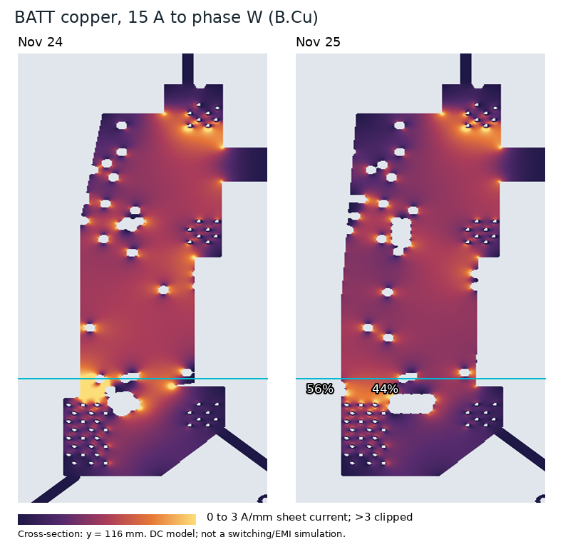
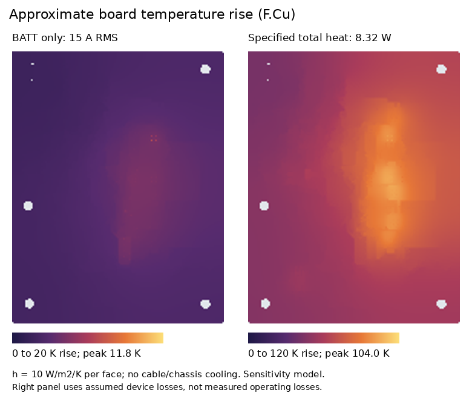

# 2026-11-25 電源銅箔・帰路・シャントと発熱の再評価

**今回の拡幅は有効。BATTの二経路には実際に電流が分かれ、前回より抵抗が下がった。相シャントを銅箔で短絡する箇所も見つからない。BATT配線単体の15 Aは現実的な検討範囲になっている。ただし、基板全体の15 A相電流連続運転は、FETのスイッチング損失と実装後の冷却条件を確認して判断する。**

対象はレビュー開始時に保存されていたPCB・回路図。`manifest.json`に元ファイルのSHA-256を保存した。KiCad 10.0.8でコピーだけをベタ再充填し、DRCと回路図照合を実施した。設計ファイル・配置・配線は変更していない。比較対象は `/tmp/ene1-review-20261124` に残っていた前回レビュー時の再充填済み基板。

## 1. 今回確認できたこと

| 項目 | 結果 |
|---|---|
| SPA / SPB / SPC とGNDの銅箔接触 | F / In1 / In2 / Bの各層で交差なし |
| R46両端を迂回する銅箔接触 | +BATT と Net-(J1-Pin_1) の全層で交差なし |
| 回路図との接続不一致 | 0件 |
| 非除外の未接続・短絡・クリアランス違反 | 0件 |
| DRCの残り | 非除外はライブラリ差異13件、ライブラリ参照問題4件。除外は既存のUSB関連8件、INAクリアランス3件、U4内部接続相当の未接続1件 |
| In1 GNDベタ | 再充填後も1つの連続した領域。信号ビア列で基板全幅を切断していない |
| GNDビア | 前回92本 → 今回263本。総ビア316本 → 487本 |
| BATTビア | 50本。主な改善はB.Cu形状の拡幅・障害物周囲の整理 |

シャント確認はネット名だけでなく、ベタ・パッド・配線・ビアの銅箔形状を合成して異なるネットとの交差を調べた。結果は `shunt_geometry_check.json`。SP側はローサイドFETのソース→シャントpad 1、pad 2側はGNDという構成を保っている。別層で同じ座標にGNDが存在していても、それだけで短絡にはならない。

USBについてはユーザーの製造判断を受け入れ、今回の追加修正要求にはしていない。DRC除外を含むため、「DRCの警告がすべてゼロ」という意味ではない。

## 2. 実形状から作った電気抵抗モデル

KiCadの再充填済み銅箔を格子化し、隣接する銅箔セルを抵抗で接続した有限体積近似。各層の電流は実際のビア・スルーホールでのみ層間移動する。上下に重なっただけの銅箔は電気的には接続していない。

- 銅厚：F/B 35 µm、In1/In2 17 µm。基板ファイルのスタックアップを使用。
- 銅抵抗率：20℃で1.724×10⁻⁸ Ωmという仮定値。温度係数0.00393/K。
- ビアめっき：20 µmと仮定。実製造の保証値ではない。
- 部品の同一端子に属するパッドとビアの局所リングを等電位に近似。はんだ・リード・ケーブル・接触抵抗は除外。
- BATTは0.20 / 0.10 / 0.05 mm格子で比較。0.10→0.05 mmの差は各経路0.3～0.7%。最細モデルは約30万節点。
- GNDは0.20 / 0.15 mm格子で比較。抵抗差は0.2～0.9%。最細モデルは約80万節点。
- IC(0)前処理付き共役勾配法で解き、各1 A注入の残差は約10⁻⁹ A以下。入力電力と抵抗損失も一致。
- 既知の平行抵抗、40×10 mmの一様銅箔、一様発熱板の解析解と照合した。`solver_validation.json`参照。

格子の収束確認は数値解の再現性を示す。実際の銅厚・接合抵抗・部品損失・放熱条件まで同じ精度で分かるという意味ではない。

### BATTの抵抗と二経路の分担

下表の抵抗はR46の**BATT側パッドから各ハイサイドFETのドレインまで**。R46自身の1 mΩは含めない。前後比較は同じ0.10 mm格子。

| 経路 | 前回 | 今回 | 改善 |
|---|---:|---:|---:|
| R46 → Q1（U） | 0.813 mΩ | 0.776 mΩ | 約5%低減 |
| R46 → Q3（V） | 1.840 mΩ | 1.608 mΩ | 約13%低減 |
| R46 → Q5（W） | 2.431 mΩ | 2.168 mΩ | 約11%低減 |

最も遠いW相に15 Aを送るDC試験条件では、y=116 mmのB.Cu断面で以下の分担になる。

- 左経路 x≈134.0～139.0 mm：約56.1%、8.4 A。
- 右経路 x≈140.7～145.9 mm：約43.9%、6.6 A。

**二経路とも有効。全電流が片方の細い隙間だけを通る状態ではない。** ただし分担は負荷位置によって変わり、常に半分ずつではない。抵抗低減で発熱自体が減り、熱も周囲の銅箔へ拡散する。一方、共通の基板全体が熱くなれば両経路とも熱くなるので、二経路化だけで冷却が不要になるわけではない。



画像はB.Cuの**幅あたり電流（A/mm）**で、体積電流密度A/mm²でも温度でもない。矢印や色からPWMの高周波電流経路を推定するための図ではない。

### GNDの帰路

| 経路 | 前回・0.20 mm格子 | 今回・0.20 mm格子 | 今回・0.15 mm格子 |
|---|---:|---:|---:|
| R1 GND側 → J6 | 0.540 mΩ | 0.476 mΩ | 0.480 mΩ |
| R3 GND側 → J6 | 0.825 mΩ | 0.719 mΩ | 0.714 mΩ |
| R4 GND側 → J6 | 0.737 mΩ | 0.722 mΩ | 0.721 mΩ |

U/V側の帰路は約12～13%低減。W側は以前から広い帰路があり、改善は約2%。W→J6のDC試験条件で、y=105 mmの断面はF約16%、In1約39%、In2約11%、B約34%に分担する。**Fの細い一箇所だけが全電流を運ぶ構造ではなく、In1とBのGNDも実際に働いている。**

この層別比率はその断面・負荷条件での値。各シャント出口やバッテリー端子の直近では層移動があるため、どこでも同じ割合ではない。

### SPと入力側

| 銅箔経路 | 抵抗・20℃ | 15 A RMSでの損失 |
|---|---:|---:|
| Q2 source → R1 SPA | 0.089 mΩ | 0.020 W |
| Q4 source → R3 SPB | 0.098 mΩ | 0.022 W |
| Q6 source → R4 SPC | 0.095 mΩ | 0.021 W |
| J1 → R46入力側 | 0.101 mΩ | 0.023 W |

短いSP銅箔の発熱は2 mΩ抵抗本体よりずっと小さい。表面だけだから直ちに追加層が必要、という結果ではない。2 mΩ抵抗本体は15 A RMSがその抵抗を常時流れるなら0.45 W、30 A RMSなら1.8 W。実際のローサイド導通率によって平均は変わる。

## 3. BATT配線の発熱

Wまでの2.17 mΩ経路に、指定した電流が流れる試験条件。**「相15 A RMS」と「BATT配線15 A RMS」は同義ではない。** FOCの電池平均電流、相電流、PWMリップルを含む各銅箔のRMS電流は区別する。

| BATT経路のRMS電流 | 電圧降下・20℃ | 銅箔損失・20℃ | 銅箔損失・80℃相当 |
|---|---:|---:|---:|
| 5 A | 10.8 mV | 0.054 W | 0.067 W |
| 8 A | 17.3 mV | 0.139 W | 0.171 W |
| 15 A | 32.5 mV | 0.488 W | 0.603 W |
| 30 A | 65.0 mV | 1.951 W | 2.411 W |

30 Aは15 Aの4倍の発熱。30 Aの瞬間ピークと30 A連続を同じ扱いにはしない。5 Aサーキットブレーカも瞬間的に5 Aへ制限する装置ではなく、相電流の上限を直接決めない。

## 4. 熱抵抗網による概算

電気モデルの各抵抗で発生した熱を、実銅箔の位置へ与えた。4枚の熱伝導シート、FR4の層間伝導、ビアの熱伝導、基板両面から外気への熱伝達を含む0.5 mm格子の簡易モデル。

仮定：Cu熱伝導率385 W/(m K)、FR4 0.4 W/(m K)、FR4体積熱容量1.8 MJ/(m³ K)。実際のJLCの積層材は未同定で、0.4は[Isola 370HRの公表例](https://www.isola-group.com/wp-content/uploads/data-sheets/370hr-laminate-prepreg.pdf)を参考にした値。両面それぞれの実効熱伝達率h=5 / 10 / 15 W/(m² K)で感度を比較。放射は独立計算せず実効hに含めた。外部配線、筐体、取付ねじ、ヒートシンクへの冷却はゼロとした。

### BATT銅箔だけを発熱させた場合

抵抗を一律80℃相当に増やした、保守的な固定発熱条件。他の部品は発熱させない。

| 条件 | 基板上の最大温度上昇 | B.Cu BATT領域の最大温度上昇 |
|---|---:|---:|
| 15 A RMS・定常、h=5～15 | 約10～17℃ | 約6～13℃ |
| 30 A RMS・定常、h=5～15 | 約41～66℃ | 約26～51℃ |
| 30 Aを冷間から60秒、h=10 | 約35℃ | 約20℃ |

15 Aの最大温度位置はB.Cuの広い中央そのものより、F側を含む接続部寄り。30 A×60秒の結果は**配線だけ**の上昇であり、FET・シャント・レギュレータ等の温度を足し込んだ運転温度ではない。熱容量には部品・電線を含めておらず、これも実測値ではない。

### パワー段の熱を加えるとどうなるか

[TPH2R70AR5のデータシート](https://toshiba.semicon-storage.com/info/TPH2R70AR5_datasheet_en_20250425.pdf?did=162761&prodName=TPH2R70AR5)のRDS(on)最大2.7 mΩ・VGS=10 V・25℃を使うと、平衡三相15 A RMSでFET6個合計の導通損失は

`Pcond = 3 × 15² × 2.7 mΩ = 1.82 W`。

温度上昇でRDS(on)が1.5倍になったという感度条件では2.73 W。これはスイッチング損失・逆回復・デッドタイム損失を含まない。各FETの平均損失はPWM方式、電流波形、デューティにも依存する。

次は運転点の再現ではなく、**指定した発熱量を置いた場合の冷却感度評価**。銅箔は別々のDC試験の厳しめの熱分布を重ね、相シャント合計0.675 W、R46に0.064 W、制御・電源IC合計1 Wを仮定した。各相のPWM状態やモータモデルを解いてはいないため、同時に成立する一つのスイッチ状態を表すものではない。相出力銅箔の損失、電解ESR損失などの未計上分もある。

| FET6個の指定発熱 | 基板への指定発熱合計 | h=10時の基板最大温度上昇 |
|---|---:|---:|
| 2.73 W（温度上昇後の導通相当） | 5.32 W | 約63℃ |
| 5.73 W（さらに3 Wを仮置き） | 8.32 W | 約104℃ |
| 8.73 W（さらに6 Wを仮置き） | 11.32 W | 約145℃ |

この高温側の数値を実運転の予言として使わないこと。定数固定の線形モデルであり、高温時の放射・部品特性・温度依存損失は非線形になる。**読み取るべき点は「BATT銅箔0.6 Wより、FETを含む数Wの発熱と筐体内の放熱が支配的になり得る」こと。** 初回はFET・各相シャント・R46近くの接続部を測温し、定常温度とゲート設定の関係を確認する。



## 5. リターンパスとノイズの判断範囲

F配線に近いIn1 GNDは継続しており、今回の信号ビア整理で大きな分断は確認しなかった。電源帰路を複数層へ分散できている点もよい。一方、このDCモデルでリンギング・誘導性GNDバウンス・クロストークまで保証することはできない。

PWMの急峻な電流はJ1/J6まで毎回戻るのではなく、各相のDCリンクMLCCとFET・シャント周辺を含む局所ループを流れる。20 kHzという繰返し周波数だけでなく、スイッチングの立上り・立下り時間が効く。電池帰路の抵抗が小さくても局所ループのインダクタンスは残る。C14は上側へ移されているが、W相直近のC44/C57が高周波バイパスを担う構成は維持されている。

現状の電源配線を大きく引き直す必要があるという新しい根拠は見つからなかった。ゲート波形・相ノードのオーバーシュートとADCのPWM同期ノイズは、初回基板で確認する。

## 6. 前の質問：DRVとINAのパッド

- **DRV U1**：今回の中央銅箔は4.0418 mm角に変更されている。実物のEPは4.15±0.10 mm角で、6 mm角の本体に対して中央が広いのは正常。銅箔寸法自体より、中央がF.Pasteにも一枚で含まれている点が実装上の確認事項。TIの例は中央9分割・約71%開口。銅箔を小さくすることとステンシルのペースト量を減らすことは別で、今の約4.04 mm角でも一枚開口なら実物EP公称面積の約95%を覆う。[TI DRV8353F、RTA0040B、PDF80～82ページ](https://www.ti.com/lit/ds/symlink/drv8353f.pdf)
- **INA U5**：現状はピッチ0.65 mm、ランド幅0.50 mmで隙間0.15 mm。DGK実物の足幅は0.25～0.38 mmなので、名目ピッチから計算した足同士の隙間は約0.27～0.40 mm。ランドの方を広くしているため画面では詰まって見える。TIのDGKランド例は幅0.45 mm・長さ1.4 mmで、ランド間隔0.20 mm。現状は手はんだ向けに長く広げた形で、実物の足が接触する寸法ではない。ペースト量・位置ずれによるブリッジは確認する。DGK共通パッケージ図面を照合した。[TI DGK0008A図面、OPA380資料PDF23～25ページに収録](https://www.ti.com/lit/ds/symlink/opa380.pdf)

DRVのペースト開口は製造前の確認事項として継続。今回、パッドやステンシルを勝手には変更していない。

## 7. 判断と成果物

- **即修正の新しい配線不具合**：今回の対象範囲ではなし。
- **製造前確認**：DRV中央ペースト開口の扱い。既知のライブラリ差異は基板に埋め込まれた形状を正として確認する。
- **実測が必要**：FETのスイッチング損失・実装後の冷却、相ノード過渡、センス波形。
- **BATT配線**：二経路の改善を数値確認できた。15 A RMSの配線損失を理由に、追加の広範囲レジスト開口や無条件の導線補強を要求する結果ではない。
- **15 A相電流連続運転の承認**：この計算だけでは確定しない。銅箔の改善後は、FETの発熱と放熱条件の確認が優先。

詳細数値は `results.json`、電源層図は `power_layers.png`。再現用に旧・新の抽出済み銅箔形状をgzipで保存した。中間行列・実行バイナリはローカル専用としてGitから除外。

再実行例（Python 3 + Pillow、g++が必要）：

```sh
cd reviews/2026-11-25-power-simulation
g++ -O3 -std=c++17 solve.cpp -o solve
gzip -dc new_geometry.json.gz > /tmp/ene1-new-geometry.json
python3 model.py /tmp/ene1-new-geometry.json 0.1 new batt
python3 model.py /tmp/ene1-new-geometry.json 0.2 new gnd
python3 model.py /tmp/ene1-new-geometry.json 0.1 new input
python3 model.py /tmp/ene1-new-geometry.json 0.1 new spa
python3 model.py /tmp/ene1-new-geometry.json 0.1 new spb
python3 model.py /tmp/ene1-new-geometry.json 0.1 new spc
python3 thermal.py /tmp/ene1-new-geometry.json 10
python3 thermal.py /tmp/ene1-new-geometry.json 10 transient
python3 validate_solver.py
```

旧版比較は `old_geometry.json.gz`を解凍して `model.py ... 0.1 old batt`等を実行する。`results.py`は旧新版の電気モデルとh=10の定常熱モデルを作成後に使用する。
